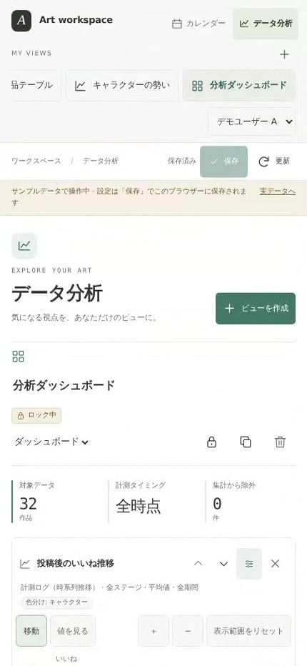
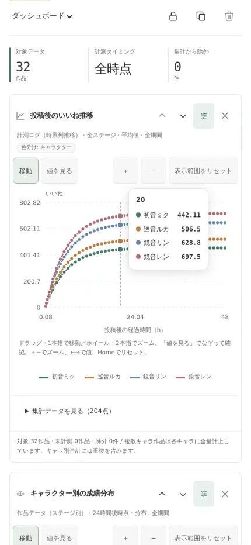
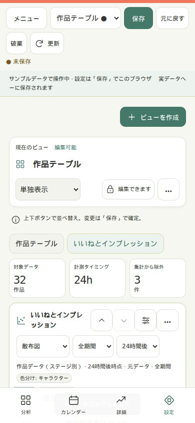
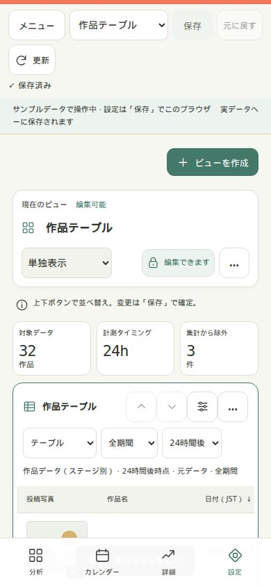
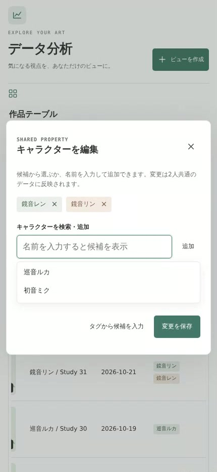
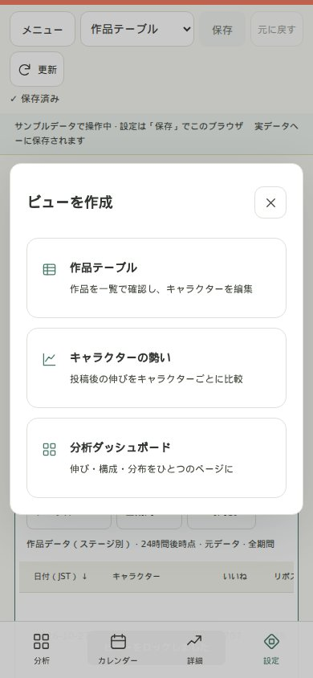
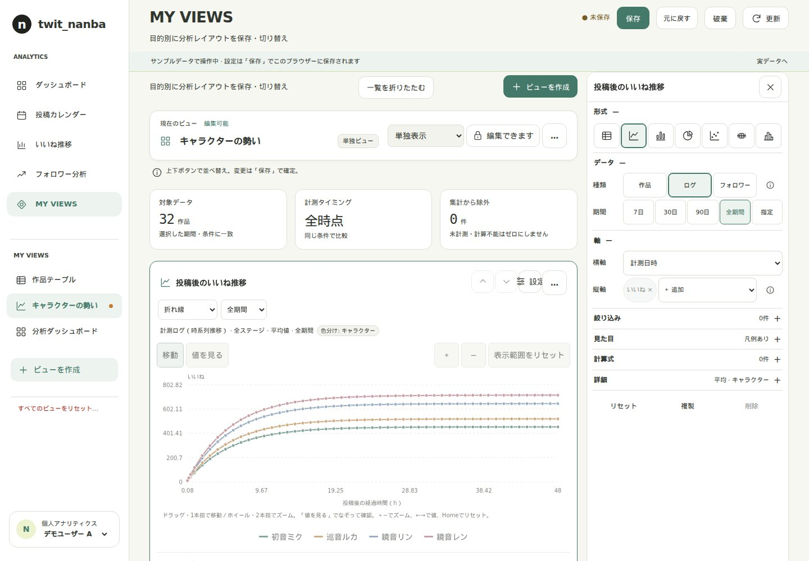
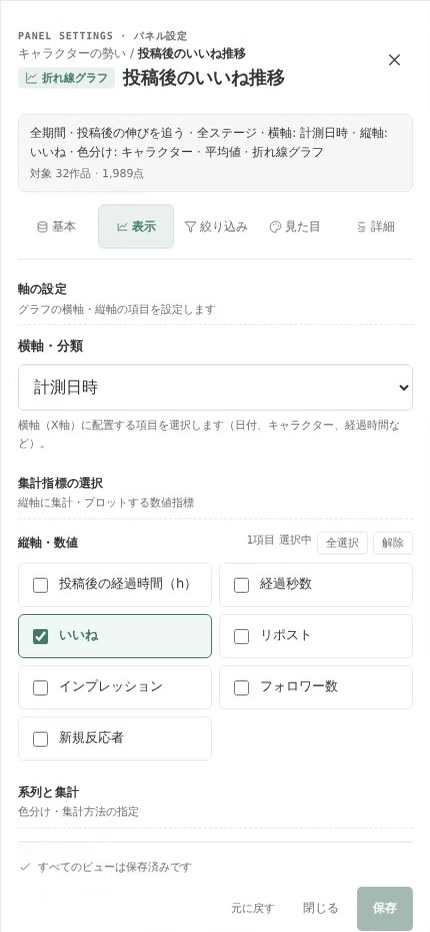
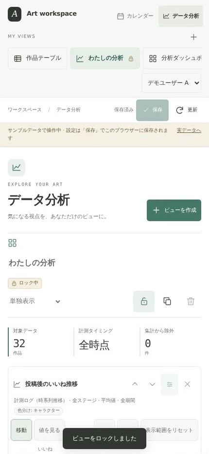

# データ分析の使い方

スマホで、作品の反応を確認して、自分の分析ビューを作るためのガイドです。

画面例はデザイン改修前（f9e5875）の実アプリをスマホ表示で操作したものです。現在は文字・余白・カード・設定欄の見た目を改善していますが、以下のカスタマイズ操作は共通です。作品・画像・数値はデモ用サンプルです。実データ画面では、お使いの環境に保存された作品が表示されます。

## 1. 分析画面を開く

アプリ上部の「データ分析」をタップします。直接開く場合は、アプリのURL末尾に `/analytics` を付けます。練習だけしたい場合は `/analytics?demo=1` を開いてください。

上部の利用者名を選びます。ビュー設定は利用者ごとに分かれます。実データモードでは、別の端末でも同じ利用者を選ぶと保存済みビューを使えます。

利用者名は設定を分けるためのものです。本人確認やアクセス制限ではありません。作品データとキャラクター編集は利用者間で共通です。

## 2. ビューの見方

「ビュー」は、見たい表・グラフと、その条件をまとめて保存したものです。ビューの中にある1つの表やグラフを「パネル」と呼びます。

### 保存したビューを切り替える

上部の「MY VIEWS」に並ぶビュー名をタップします。スマホでは名前の列を横にスワイプすると、ほかのビューを探せます。

選択中のビューは緑の背景と枠で表示されます。未保存の変更には印が付き、ロック中のビューには鍵が表示されます。「現在のビュー」の「編集可能」はロック解除中であることを表します。

| 表示 | どんなときに使うか |
|---|---|
| 作品テーブル | どの作品がどれだけ反応されたか、写真と数値で確認する |
| キャラクターの勢い | 投稿からの経過時間に沿って、キャラクターごとの伸びを比べる |
| 分析ダッシュボード | 推移・分布・構成など、いくつものグラフを順に見る |

実データモードでまだビューがなければ、後述の「ビューを作成」から始めます。

### 単独表示とダッシュボード

ビュー名の下にあるレイアウト選択で切り替えます。「単独表示」はパネルをタブで切り替えて1つずつ見ます。「ダッシュボード」は複数のパネルを同時に配置します。スマホでは縦に並ぶので、下へスクロールして確認します。この変更も「保存」で確定します。

### グラフの前に確認する3つの数字

| 表示 | 読み方 |
|---|---|
| 対象データ | 選択した期間・条件に一致する作品などの数 |
| 計測タイミング | 24hなど、どの計測時点を比較しているか。「全時点」は複数時点のログを扱う |
| 集計から除外 | 未計測・計算できない値などで、集計に入らなかった件数 |

24hの作品比較なら、投稿24時間後の計測同士を比べます。24hが未計測の作品に、最新値や0を代入することはありません。グラフごとの説明行でも、データ種類・時点・集計方法を確認してください。

## 3. グラフを読む・タッチで調べる

まず横軸・縦軸と凡例を見ます。下の例は横軸が「投稿後の経過時間」、縦軸が「いいね」、色がキャラクターです。これは各キャラクターの平均の推移で、1本の線が1作品を表すわけではありません。

1. 点や図形をタップして値を確認します。
2. なぞりながら値を見たいときは「値を見る」に切り替えます。
3. 細かい範囲を見るときは「＋」で拡大します。2本指のピンチでも拡大・縮小できます。
4. 「移動」に戻し、拡大したグラフを1本指で動かします。
5. 「表示範囲をリセット」で全体へ戻ります。

凡例の名前をタップすると、その系列の表示を切り替えられます。正確な数値を一覧で確認したい場合は、グラフ下の「集計データを見る」を開きます。

ページを上下にスクロールするときは、グラフの外側から指を動かすと操作が混ざりにくくなります。ズームや移動は閲覧中の一時的な状態です。保存する分析条件や計測データは変わりません。

### どのグラフを選べばよい？

| グラフ | 見たいこと |
|---|---|
| 折れ線 | 時間とともにどう伸びたか |
| 棒グラフ | キャラクターなど、分類ごとの大小 |
| 円グラフ | 全体に占める構成比 |
| 散布図 | いいねとインプレッションなど、2つの項目の関係 |
| 箱ひげ図 | 分類ごとの中央値と、成績のばらつき |
| ヒストグラム | どの数値帯の作品が多いか |

### 散布図から作品を確認する

散布図の各点をタップすると、作品ごとの点では写真・作品名・いいね・リポスト・計測時点を表示します。点が右にあるほど横軸の値が大きく、上にあるほど縦軸の値が大きい、と読みます。

カードの数値は、その点の計測時点の値です。常に最新の反応数を示すわけではありません。複数作品をまとめた集計点や、フォロワー履歴などには作品カードは出ません。また、2項目に関係が見えても、そのまま原因と結果が分かるわけではありません。

## 4. 写真テーブルで作品を探す

「作品テーブル」を開くと、投稿写真、作品名、日付、キャラクター、反応数などが並びます。スマホでは表の中を横にスワイプすると、右側の数値列を確認できます。

列の見出しをタップすると昇順・降順を切り替えられます。パネル右上の設定ボタンから「表示」を開けば、表示列、写真の表示、グループ化、最大5条件の並べ替えを設定できます。複数条件は上から優先されます。たとえば「いいねが多い順、その中では日付順」という並べ方ができます。

写真をタップすると作品詳細を開けます。写真に付いた「4枚」などの数字は、その投稿の画像枚数です。

### キャラクターを追加・修正する

1. 表を横にスワイプして「キャラクター」列を表示し、編集したい行の名前をタップします。
2. 入力欄に名前の一部を入れます。一致する候補が最大5件表示されます。
3. 候補をタップして選択へ追加します。複数のキャラクターを選べます。
4. 選択から外すときは、名前のチップの「×」をタップします。
5. 「変更を保存」をタップして確定します。

候補にない名前も、入力欄から追加できます。キャラクターの変更は作品そのものの編集で、全利用者に共通して反映されます。ビュー設定の保存とは別です。

## 5. 最初のビューを作る

まずは「キャラクターごとの投稿後の伸び」を見るビューを作ってみましょう。

1. 分析画面の「ビューを作成」をタップします。
2. テンプレートから「キャラクターの勢い」を選びます。
3. 作成されたビューの名前をタップし、分かりやすい名前に変更します。例：「キャラ別のいいね推移」。
4. グラフを確認します。このテンプレートは、投稿からの経過時間に沿ってキャラクター別のいいね推移を比べます。
5. 画面上部の「保存」をタップし、「保存済み」を確認します。

作品を一覧で整理したいときは「作品テーブル」、複数のグラフをまとめたいときは「分析ダッシュボード」から始めると設定を減らせます。

## 6. 自分の見たい条件に変える

各パネル右上のスライダー形の設定ボタンをタップします。スマホでは設定画面が大きく開きます。中をスクロールして、必要な項目だけ変更してください。

設定の見出し・5つのタブ・下部の保存操作を表示したまま、中央の設定項目をスクロールできます。長いパネル名や狭い画面でも項目は折り返して表示されます。

| タブ | ここで変えるもの |
|---|---|
| 基本 | データ種類、期間、グラフ形式、作品比較の計測時点など |
| 表示 | 横軸、縦軸、色分け、集計方法。表の場合は列・グループ・並べ替えなど |
| 絞り込み | 特定のキャラクターなど、集計する行の条件 |
| 見た目 | 色、凡例、軸ラベル、軸の範囲、目盛り間隔など |
| 詳細 | 独自の計算式など。通常の分析では、最初は変更不要 |

### データ種類を選ぶ基準

| データ種類 | 何を1行として扱うか | 用途 |
|---|---|---|
| 作品データ | 1作品の指定した計測時点 | 投稿24h後のいいねを作品間で比べる |
| 計測ログ | 1作品の1回の計測 | 投稿後の伸びを時間に沿って追う |
| フォロワー推移 | アカウント全体の1回の計測 | アカウント全体のフォロワー数の推移を見る |

フォロワー推移はアカウント全体の記録で、特定の作品・キャラクターが獲得したフォロワー数ではありません。

### 例A：投稿後の伸びを見る

「キャラクターの勢い」テンプレートの設定で、「表示」の横軸を「投稿後の経過時間（h）」、縦軸を「いいね」、色分けを「キャラクター」にします。集計方法を平均にすると、キャラクターごとの平均の伸びを比べられます。

### 例B：カレンダー上の日時で見る

同じ計測ログでも、横軸を「計測日時」に変えると、実際に計測した日付・時刻の順に見られます。投稿から同じ時間が経った作品をそろえて比較したいときは、例Aの経過時間に戻してください。

設定上部のサマリーで期間・データ・軸を確認し、下部の「保存」で確定します。「閉じる」だけでは保存されません。「元に戻す」は直前の設定変更を取り消す操作です。

### 例C：いいねとインプレッションの関係を見る

1. 設定を閉じ、ビューの下にある「表・グラフを追加」をタップします。
2. 「散布図」を選びます。
3. 「基本」で作品データと比較時点（例：24h）を確認します。
4. 「表示」で横軸を「インプレッション」、縦軸を「いいね」、色分けを「キャラクター」にします。
5. 「保存」して閉じ、点をタップして作品を確かめます。

複数パネルを同じページに並べる場合は、レイアウトを「ダッシュボード」にします。パネル右上の上下ボタンで順番を変更できます。

## 7. 保存して、次回も同じ見方を使う

設定は自動保存ではありません。画面上部か設定下部の「保存」をタップし、「保存済み」になったことを確認します。保存ボタンは未保存のビューの変更をまとめて保存します。

「更新」はデータの再集計です。設定の保存や、Xの数値の新規取得をするボタンではありません。保存したビューは、開くたびにその条件で現在のデータを集計します。「直近30日」などの相対期間なら、対象期間も日付に合わせて動きます。

デモモードではビュー設定を同じブラウザーに保存します。実データモードのように、別端末へ設定を共有するものではありません。

### 完成したビューをロックする

保存後、ビュー名付近の鍵ボタンをタップします。ロック中は名前・レイアウト・パネル設定・並べ替え・削除などを変更できません。再編集するときは同じ鍵ボタンで解除します。ロック状態は切り替え時に保存されます。

元の設定を残して試すなら、鍵の隣の複製ボタンで別ビューを作ります。ごみ箱ボタンでビューを削除しても、作品や計測履歴は削除されません。保存せず別の利用者へ切り替えないようにしてください。

## 8. 困ったとき

| 状況 | 確認すること |
|---|---|
| データが出ない | 全期間に戻す、絞り込みを解除する、選択した計測時点の記録があるか確認する |
| 数値が想定と違う | 平均か合計か、期間、計測時点、複数キャラの配分、除外件数を確認する |
| グラフが動くが値を追えない | 「値を見る」へ切り替える |
| ページをスクロールしづらい | グラフの外から指を動かす |
| 表の数値やキャラが見えない | 表の中を横にスワイプする |
| 編集ボタンが使えない | 鍵ボタンでロックを解除する |
| 保存が失敗した | 未保存表示を確認して再試行する。別タブとの競合案内が出たら保存先を選ぶ |

本ガイドの旧画面例にある、未ロック時の「ロック中」バッジと狭い設定画面のはみ出しは、今回のCSS改修で修正しています。現在の調査範囲・デザイン方針・検証結果は [分析画面のデザイン改修](analytics-ui-redesign.md) を参照してください。

複数キャラクターを「全量」で集計すると、同じ作品が各キャラクターに計上されるため、分類別の合計は全作品の合計と一致しない場合があります。キャラ間で分けたいときは「均等」、組み合わせでまとめたいときは「組み合わせ」を選びます。

日付の区切りは日本時間です。さらに詳しい集計・計算式の仕様は [データ分析の仕様](analytics_prototype.md) を参照してください。
