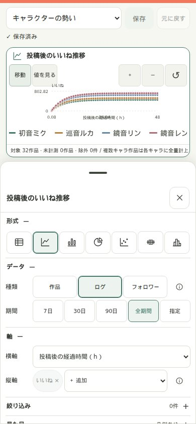

# データ分析の使い方

スマホで、作品の反応を確認して、自分の分析ビューを作るためのガイドです。

画面例は新しい設定ペインをデモモードで操作したものです。作品・画像・数値はサンプルです。実データ画面では、お使いの環境に保存された作品が表示されます。

## 1. 分析画面を開く

`/analytics` で分析ダッシュボードを開きます。月間の投稿・いいね・フォロワー増減と投稿ハイライトを確認できます。上部で月を切り替え、「表示設定」で表示パネルを選びます。表示設定は「保存」でこのブラウザーに保存します。フォロワーは作品ごとの値ではなく、アカウント全体の計測です。

保存ビューを使う場合は、左メニューの「MY VIEWS」（スマホでは下部の「設定」）を選びます。直接開くURLは `/analytics#views`、練習用は `/analytics?demo=1#views` です。

左下の利用者名（スマホでは「メニュー」内）を選びます。ビュー設定は利用者ごとに分かれます。実データモードでは、別の端末でも同じ利用者を選ぶと保存済みビューを使えます。

利用者名は設定を分けるためのものです。本人確認やアクセス制限ではありません。作品データとキャラクター編集は利用者間で共通です。

## 2. ビューの見方

「ビュー」は、見たい表・グラフと、その条件をまとめて保存したものです。ビューの中にある1つの表やグラフを「パネル」と呼びます。

### 保存したビューを切り替える

左の MY VIEWS 一覧からビュー名を選びます。一覧は「一覧を折りたたむ」でアイコンだけにできます。スマホではヘッダーのビュー切替から選び、利用者は「メニュー」から切り替えます。

選択中のビューは淡いセージ色の背景と枠で表示されます。未保存の変更には印が付き、ロック中のビューには鍵が表示されます。「現在のビュー」の「編集可能」はロック解除中であることを表します。

| 表示 | どんなときに使うか |
|---|---|
| 作品テーブル | どの作品がどれだけ反応されたか、写真と数値で確認する |
| キャラクターの勢い | 投稿からの経過時間に沿って、キャラクターごとの伸びを比べる |
| 分析ダッシュボード | 推移・分布・構成など、いくつものグラフを順に見る |

実データモードでまだビューがなければ、後述の「ビューを作成」から始めます。

### 単独表示とダッシュボード

ビュー名の下にあるレイアウト選択で切り替えます。「単独表示」はパネルをタブで切り替えて1つずつ見ます。「ダッシュボード」は複数のパネルを同時に配置します。スマホでは縦に並ぶので、下へスクロールして確認します。この変更も「保存」で確定します。

### グラフの前に確認する3つの数字

| 表示 | 読み方 |
|---|---|
| 対象データ | 選択した期間・条件に一致する作品などの数 |
| 計測タイミング | 24hなど、どの計測時点を比較しているか。「全時点」は複数時点のログを扱う |
| 集計から除外 | 未計測・計算できない値などで、集計に入らなかった件数 |

24hの作品比較なら、投稿24時間後の計測同士を比べます。24hが未計測の作品に、最新値や0を代入することはありません。グラフごとの説明行でも、データ種類・時点・集計方法を確認してください。

## 3. グラフを読む・タッチで調べる

まず横軸・縦軸と凡例を見ます。下の例は横軸が「投稿後の経過時間」、縦軸が「いいね」、色がキャラクターです。これは各キャラクターの平均の推移で、1本の線が1作品を表すわけではありません。

1. 点や図形をタップして値を確認します。
2. なぞりながら値を見たいときは「値を見る」に切り替えます。
3. 細かい範囲を見るときは「＋」で拡大します。2本指のピンチでも拡大・縮小できます。
4. 「移動」に戻し、拡大したグラフを1本指で動かします。
5. 「表示範囲をリセット」で全体へ戻ります。

凡例の名前をタップすると、その系列の表示を切り替えられます。正確な数値を一覧で確認したい場合は、グラフ下の「集計データを見る」を開きます。

ページを上下にスクロールするときは、グラフの外側から指を動かすと操作が混ざりにくくなります。ズームや移動は閲覧中の一時的な状態です。保存する分析条件や計測データは変わりません。

### どのグラフを選べばよい？

| グラフ | 見たいこと |
|---|---|
| 折れ線 | 時間とともにどう伸びたか |
| 棒グラフ | キャラクターなど、分類ごとの大小 |
| 円グラフ | 全体に占める構成比 |
| 散布図 | いいねとインプレッションなど、2つの項目の関係 |
| 箱ひげ図 | 分類ごとの中央値と、成績のばらつき |
| ヒストグラム | どの数値帯の作品が多いか |

### 散布図から作品を確認する

散布図の各点をタップすると、作品ごとの点では写真・作品名・いいね・リポスト・計測時点を表示します。点が右にあるほど横軸の値が大きく、上にあるほど縦軸の値が大きい、と読みます。

カードの数値は、その点の計測時点の値です。常に最新の反応数を示すわけではありません。複数作品をまとめた集計点や、フォロワー履歴などには作品カードは出ません。また、2項目に関係が見えても、そのまま原因と結果が分かるわけではありません。

## 4. 写真テーブルで作品を探す

「作品テーブル」を開くと、投稿写真、作品名、日付、キャラクター、反応数などが並びます。スマホでは表の中を横にスワイプすると、右側の数値列を確認できます。

列の見出しをタップすると昇順・降順を切り替えられます。設定ペインの「軸」で列と写真を、「詳細」でグループ化と最大5条件の並べ替えを設定できます。複数条件は上から優先されます。たとえば「いいねが多い順、その中では日付順」という並べ方ができます。

写真をタップすると作品詳細を開けます。写真に付いた「4枚」などの数字は、その投稿の画像枚数です。

### キャラクターを追加・修正する

1. 表を横にスワイプして「キャラクター」列を表示し、編集したい行の名前をタップします。
2. 入力欄に名前の一部を入れます。一致する候補が最大5件表示されます。
3. 候補をタップして選択へ追加します。複数のキャラクターを選べます。
4. 選択から外すときは、名前のチップの「×」をタップします。
5. 「変更を保存」をタップして確定します。

候補にない名前も、入力欄から追加できます。キャラクターの変更は作品そのものの編集で、全利用者に共通して反映されます。ビュー設定の保存とは別です。

## 5. 最初のビューを作る

まずは「キャラクターごとの投稿後の伸び」を見るビューを作ってみましょう。

1. 分析画面の「ビューを作成」をタップします。
2. テンプレートから「キャラクターの勢い」を選びます。
3. 作成されたビューの名前をタップし、分かりやすい名前に変更します。例：「キャラ別のいいね推移」。
4. グラフを確認します。このテンプレートは、投稿からの経過時間に沿ってキャラクター別のいいね推移を比べます。
5. 画面上部の「保存」をタップし、「保存済み」を確認します。

作品を一覧で整理したいときは「作品テーブル」、複数のグラフをまとめたいときは「分析ダッシュボード」から始めると設定を減らせます。

## 6. 自分の見たい条件に変える

各パネル右上の「設定」、またはパネルの見出しを選びます。PCでは右ドック、タブレット・スマホでは下部のシートが開き、選択したグラフを見ながら編集できます。変更は少し待つとプレビューへ反映されます。

タブの代わりに、次のセクションを開閉します。閉じた見出しにも現在値の要約を表示します。

| セクション | ここで変えるもの |
|---|---|
| 形式 | アイコンで7種類から選択（名称はフォーカス・ツールチップで確認） |
| データ | 種類、作品の時点、7日・30日・90日・全期間・指定 |
| 軸 | 横軸と指標。表は列・写真、ヒストグラムは指標・区間数 |
| 絞り込み | 条件チップを開いて編集、AND/OR |
| 見た目 | 色、凡例、数値ラベル |
| 計算式 | 「＋ 追加」から新規・テンプレートを選択 |
| 詳細 | 名前、任意の日数、系列、集計、変換、配分、前期間比較、軸・目盛り、表の整理 |

初期表示は基本の5〜6項目だけです。説明は項目の ⓘ から必要なときに開き、Escで閉じます。「形式・データ・軸」以外は、条件のある絞り込みを除いて折りたたんでいます。ペイン末尾には「リセット」「複製」「削除」を1行で配置しています。

折れ線・棒の指標は選択済みチップと「＋ 追加」で選びます（最大6件）。円・散布図・箱ひげ図・ヒストグラムの指標はドロップダウンで選びます。形式を変えて非表示になった設定値は保持します。

シートのハンドルをタップすると拡大・縮小し、ドラッグでも高さを切り替えられます。下へ大きくドラッグするか、×またはEscで閉じます。

シート展開中のグラフは高さを合わせ、操作と凡例を1行で表示します。横向きの狭い画面ではグラフ本体を優先し、操作部はシートを閉じると表示します。

設定ペインにフォーカストラップはありません。閉じても変更は下書きとして残り、保存はヘッダーで行います。

パネルのヘッダーでも形式・期間・ステージを素早く変更できます。「…」には複製・リセット・削除があり、上下ボタンで順番を変えられます。

### データ種類を選ぶ基準

| データ種類 | 何を1行として扱うか | 用途 |
|---|---|---|
| 作品データ | 1作品の指定した計測時点 | 投稿24h後のいいねを作品間で比べる |
| 計測ログ | 1作品の1回の計測 | 投稿後の伸びを時間に沿って追う |
| フォロワー推移 | アカウント全体の1回の計測 | アカウント全体のフォロワー数の推移を見る |

フォロワー推移はアカウント全体の記録で、特定の作品・キャラクターが獲得したフォロワー数ではありません。

### 例A：投稿後の伸びを見る

「キャラクターの勢い」テンプレートの設定で、「軸」の横軸を「投稿後の経過時間（h）」、縦軸を「いいね」にします。「詳細」で系列を「キャラクター」、集計を「平均」にすると、キャラクターごとの平均の伸びを比べられます。

### 例B：カレンダー上の日時で見る

同じ計測ログでも、横軸を「計測日時」に変えると、実際に計測した日付・時刻の順に見られます。投稿から同じ時間が経った作品をそろえて比較したいときは、例Aの経過時間に戻してください。

閉じた見出しの短い要約で設定を確認し、プレビューのフッターで対象・除外件数を確認します。ヘッダーの「保存」で確定します。「元に戻す」は最大20履歴の設定変更を取り消す操作です。

### 例C：いいねとインプレッションの関係を見る

1. 設定を閉じ、ビューの下にある「表・グラフを追加」をタップします。
2. 「散布図」を選びます。
3. 「データ」で作品データと比較時点（例：24h）を確認します。
4. 「軸」で横軸を「インプレッション」、縦軸を「いいね」にし、「詳細」で系列を「キャラクター」にします。
5. 「保存」して閉じ、点をタップして作品を確かめます。

複数パネルを同じページに並べる場合は、レイアウトを「ダッシュボード」にします。パネル右上の上下ボタンで順番を変更できます。

## 7. 保存して、次回も同じ見方を使う

設定は自動保存ではありません。ヘッダーの「保存」をタップし、「保存済み」になったことを確認します。保存ボタンは未保存のビューの変更をまとめて保存します。

「更新」はデータの再集計です。設定の保存や、Xの数値の新規取得をするボタンではありません。保存したビューは、開くたびにその条件で現在のデータを集計します。「直近30日」などの相対期間なら、対象期間も日付に合わせて動きます。

デモモードではビュー設定を同じブラウザーに保存します。実データモードのように、別端末へ設定を共有するものではありません。

### 完成したビューをロックする

保存後、ビュー名付近の「編集できます」トグルをタップします。ロック中は名前・レイアウト・パネル設定・並べ替え・削除などを変更できません。再編集するときは「ロック中」トグルで解除します。ロック状態は切り替え時に保存されます。

ロック中も設定ペインで値を確認できます。元の設定を残して試すなら、ビューの「…」から複製します。同じメニューで名前変更・削除もできます。ビューを削除しても、作品や計測履歴は削除されません。保存せず別の利用者へ切り替えないようにしてください。

## 8. 設定を戻す・作り直す

- **元に戻す**：ヘッダーのボタンまたはCtrl/⌘+Zで直前の変更を取り消します。入力欄の中では通常の文字入力の取り消しを使います。
- **破棄**：確認後、現在のビューを最後に保存した状態へ戻します。他のビューの下書きは維持します。
- **パネルを初期値に戻す**：パネルの「…」またはペイン末尾から実行します。表示形式の既定値へ戻り、パネルIDは維持します。保存前なら「元に戻す」で取り消せます。
- **ビューを作り直す**：ビューの「…」→「テンプレートから作り直す」で3つのテンプレートから選びます。ビュー名・IDは維持し、パネルとレイアウトを下書きとして置き換えます。保存前なら取り消せます。

### すべてのビューをリセットする

MY VIEWS メニュー末尾の「すべてのビューをリセット…」を選び、まずJSONバックアップをダウンロードします。確認欄へ対象ビュー数を入力すると削除ボタンが有効になります。選択した利用者のロックされていないビューを削除し、結果に残したロック済みビューの件数を表示します。完了後はスターターテンプレートへ戻ります。ロック済みビューは一覧から再び開けます。

この全削除は保存待ちの下書きリセットとは異なり、その場で確定します。作品・計測データと他利用者のビューは残ります。バックアップJSONの自動インポート機能はありません。

## 9. 困ったとき

| 状況 | 確認すること |
|---|---|
| データが出ない | 全期間に戻す、絞り込みを解除する、選択した計測時点の記録があるか確認する |
| 数値が想定と違う | 平均か合計か、期間、計測時点、複数キャラの配分、除外件数を確認する |
| グラフが動くが値を追えない | 「値を見る」へ切り替える |
| ページをスクロールしづらい | グラフの外から指を動かす |
| 表の数値やキャラが見えない | 表の中を横にスワイプする |
| 編集ボタンが使えない | ヘッダーの「ロック中」を切り替える |
| 保存が失敗した | ヘッダーのエラーと該当項目直下の1文を確認し、「再試行」。別タブとの競合案内が出たら保存先を選ぶ |
| 形式切替後に検証エラー | 指標・横軸を確認し、必要なら「詳細」で見直す。保持した変換・比較は「形式」の解除ボタンでも解除できる |

設定ペインの設計と実装上の差分は [ビュー設定UI刷新仕様書](analytics-view-settings-redesign-spec.md) を参照してください。

複数キャラクターを「全量」で集計すると、同じ作品が各キャラクターに計上されるため、分類別の合計は全作品の合計と一致しない場合があります。キャラ間で分けたいときは「均等」、組み合わせでまとめたいときは「組み合わせ」を選びます。

日付の区切りは日本時間です。さらに詳しい集計・計算式の仕様は [データ分析の仕様](analytics_prototype.md) を参照してください。
